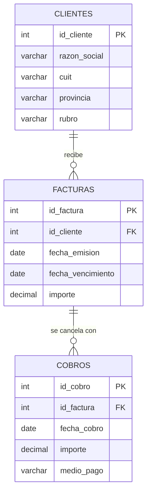
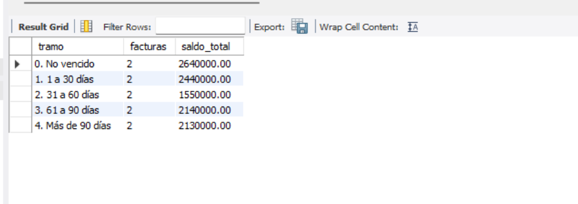
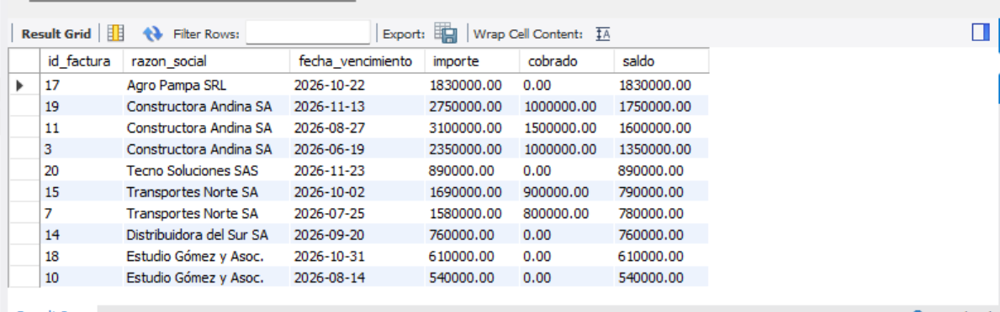
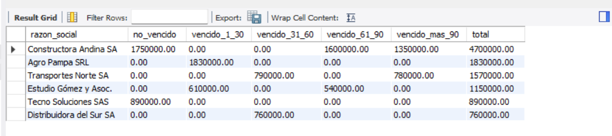

# Análisis de cuentas por cobrar con SQL

Proyecto de análisis de datos sobre la cartera de deudores de una empresa ficticia, desarrollado en **MySQL**. Responde preguntas que se hace cualquier área de finanzas o cobranzas: **cuánto nos deben, quién nos debe y desde hace cuánto**.

> Combina mi formación contable (analista contable y estudiante de Contador Público) con herramientas de análisis de datos.

---

## Preguntas de negocio

1. ¿Cuánto se facturó, cuánto se cobró y cuánto queda pendiente?
2. ¿Qué clientes concentran la facturación y la deuda?
3. ¿Cuál es el saldo pendiente de cada factura, considerando pagos parciales?
4. ¿Cómo se distribuye la deuda según su antigüedad (aging)?
5. ¿Qué acciones de cobranza deberían priorizarse?

## Modelo de datos

Tres tablas relacionadas: un cliente tiene muchas facturas y una factura puede tener varios cobros (pagos parciales) o ninguno (impaga).

- 8 clientes, 20 facturas (mayo a octubre de 2026, vencimiento a 30 días) y 16 cobros.
- Los datos son **ficticios**, creados para este proyecto.
- **Fecha de corte del análisis:** 04/11/2026.

## Herramientas y técnicas

**MySQL 8 / MySQL Workbench** · `JOIN` y `LEFT JOIN` · `GROUP BY` / `HAVING` · funciones de agregación · `COALESCE` · `DATEDIFF` · `CASE WHEN` · CTE (`WITH`)

## Estructura del repositorio

| Archivo | Contenido |
|---|---|
| `01_creacion_y_carga.sql` | Creación de la base, las tablas y carga de datos |
| `02_consultas_basicas.sql` | Filtros y ordenamientos |
| `03_agrupaciones.sql` | Totales, promedios y agrupaciones |
| `04_joins_saldos.sql` | Cruce de tablas y saldo pendiente por factura |
| `05_aging.sql` | Antigüedad de saldos por tramo y por cliente |

---

## Resultados

### Situación general

| Concepto | Importe |
|---|---|
| Total facturado | $ 23.735.000 |
| Total cobrado | $ 12.835.000 |
| **Saldo pendiente** | **$ 10.900.000** |

### Antigüedad de saldos

| Tramo | Facturas | Saldo | % del total |
|---|---|---|---|
| No vencido | 2 | $ 2.640.000 | 24,2 % |
| 1 a 30 días | 2 | $ 2.440.000 | 22,4 % |
| 31 a 60 días | 2 | $ 1.550.000 | 14,2 % |
| 61 a 90 días | 2 | $ 2.140.000 | 19,6 % |
| Más de 90 días | 2 | $ 2.130.000 | 19,5 % |
| **Total** | **10** | **$ 10.900.000** | **100 %** |

### Saldo pendiente por factura

### Aging por cliente

## Hallazgos

- **El 76 % de la cartera está vencida** ($ 8.260.000 de $ 10.900.000).
- **El 39 % de la deuda tiene más de 60 días de atraso** ($ 4.270.000), el tramo con mayor riesgo de incobrabilidad.
- **Alta concentración:** Constructora Andina SA concentra el **43 % del saldo pendiente** ($ 4.700.000), con una factura de 138 días de atraso. Aun así, se le emitió una nueva factura en octubre por $ 2.750.000.
- **Estudio Gómez y Asoc. no registra ningún cobro** en todo el período: sus dos facturas ($ 1.150.000) están impagas, una de ellas con 82 días de atraso.
- **Farmacia Central SRL y Panificadora Litoral SRL** cancelaron todas sus facturas: son los clientes de menor riesgo.
- La transferencia es el medio de cobro principal (65 % de lo cobrado), seguida por el cheque (30 %).

## Recomendaciones

1. **Priorizar la gestión de cobranza** sobre Constructora Andina SA y Transportes Norte SA, que tienen saldos con más de 90 días de atraso.
2. **Revisar los límites de crédito:** evaluar si corresponde seguir vendiendo a cuenta corriente a clientes con deuda vencida, como en el caso de Constructora Andina.
3. **Contactar a Estudio Gómez y Asoc.**, que no realizó ningún pago, antes de que su deuda pase al tramo de más de 90 días.
4. **Evaluar una previsión para deudores incobrables** sobre los saldos de mayor antigüedad, según la política contable de la empresa.
5. **Monitorear el aging en forma periódica** (por ejemplo, semanal) para detectar atrasos a tiempo.

## Cómo reproducirlo

1. Instalar MySQL 8 y MySQL Workbench.
2. Ejecutar `01_creacion_y_carga.sql` completo (crea la base desde cero).
3. Ejecutar las consultas de los archivos 02 a 05, una por una.

## Próximos pasos

- Construir un **dashboard en Power BI** con estos datos: aging, ranking de deudores y evolución de la cobranza.
- Agregar indicadores como **días promedio de cobro (DSO)** y el porcentaje de facturas cobradas en término.

---

**Autora:** Angeles Victoria Barga Torcisi · www.linkedin.com/in/angeles-victoria-barga-torcisi-658665213
